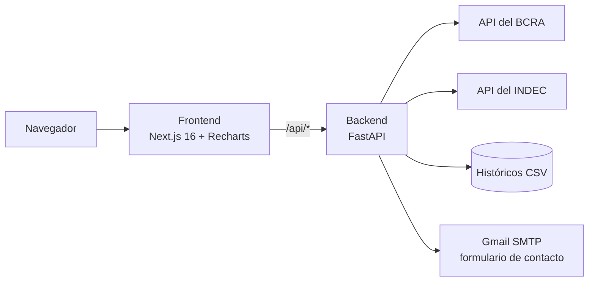

# Prognosis


**Prognosis** es un sitio de indicadores económicos de Argentina. Reúne las series oficiales del
**Banco Central (BCRA)** y del **INDEC**, las limpia y unifica, y las presenta en gráficos, tablas y
herramientas pensadas para tomar decisiones de negocio: precios, costos, financiamiento e inversión.

## Qué se puede hacer

| Sección | Contenido |
|---|---|
| **Inicio** | Cotización del dólar mayorista, "Lectura del día" con diez indicadores clave, quiénes somos y quién soy |
| **Mercado** | Reservas, dólar minorista y mayorista, tasa BAIBAR, base monetaria e ITCRM, con series desde 1996, rangos, estadísticas y descarga en CSV |
| **INDEC** | 18 series clave (inflación, precios mayoristas, construcción, salarios, canastas, pobreza, desempleo, EMAE, industria, minería y población), comercio exterior por año desde 1986 y un explorador de las 19 tablas del Catálogo API-INDEC |
| **Inflación** | Calculadora de inflación acumulada entre dos meses cualesquiera desde enero de 1992 |
| **Contacto** | Formulario que envía la consulta por correo |

Arriba de todas las páginas corre una cinta con las últimas cotizaciones.

## Fuentes de datos

- **BCRA:** [API de Estadísticas v4.0](https://www.bcra.gob.ar/BCRAyVos/catalogo-de-APIs-banco-central.asp), complementada con series históricas en CSV desde 1996. El ITCRM se toma del Excel que publica el BCRA.
- **INDEC:** [Catálogo API-INDEC](https://api.indec.gob.ar/docs). Requiere un token personal gratuito.
- **Inflación:** IPC del INDEC (variación mensual) obtenido de la API del BCRA. Para 2007–2015, cuando el IPC oficial fue cuestionado, la calculadora cita como referencia a Cavallo, A. (2012), *Online and official price indexes: Measuring Argentina's inflation*, [doi:10.2139/ssrn.1906704](https://doi.org/10.2139/ssrn.1906704).

## Arquitectura



- El **backend** (`backend/`) une el histórico local con lo nuevo de cada API, guarda los resultados en caché en memoria y expone una API REST. Los tokens y contraseñas nunca salen de él.
- El **frontend** (`frontend/`) es una app de Next.js. Las llamadas a `/api/*` las reenvía al backend.

```
├── backend/
│   ├── app.py              # API FastAPI: rutas y cabeceras de seguridad
│   ├── indicadores.py      # Series del BCRA (CSV histórico + API v4.0)
│   ├── itcrm_bcra.py       # ITCRM desde el Excel del BCRA
│   ├── indec.py            # Cliente del Catálogo API-INDEC, series clave y comercio exterior
│   ├── correo.py           # Formulario de contacto
│   ├── config.py           # Configuración leída del entorno
│   └── data/               # Históricos CSV y catálogo de tablas del INDEC
├── frontend/
│   └── src/
│       ├── app/            # Páginas: inicio, mercado, indec, inflacion, contacto
│       ├── components/     # Gráficos, paneles y secciones
│       ├── lib/            # Formatos, períodos, datos compartidos y perfil
│       └── services/api.js # Cliente de la API
├── DESPLIEGUE.md           # Guía para publicar en Vercel
└── .github/workflows/      # Escaneo de secretos en cada push
```

## Correrlo en tu computadora

Requisitos: **Python 3.12** y **Node.js 20 o superior**.

### 1. Backend

```bash
cd backend
python -m venv venv
venv\Scripts\activate          # Windows (en macOS/Linux: source venv/bin/activate)
pip install -r requirements.txt
cp .env.example .env           # completá los valores
uvicorn app:app --reload --port 8000
```

La documentación interactiva queda en http://localhost:8000/docs.

### 2. Frontend

```bash
cd frontend
npm install
cp .env.example .env.local
npm run dev
```

Abrí http://localhost:3000.

### Variables de entorno

Las plantillas son `backend/.env.example` y `frontend/.env.example`. Los archivos `.env` reales están en
`.gitignore` y **nunca** se suben al repositorio.

| Variable | Dónde | Para qué |
|---|---|---|
| `INDEC_TOKEN` | backend | Token del Catálogo API-INDEC (se genera en tu perfil de api.indec.gob.ar). Vence: cuando expira, generá uno nuevo y reemplazalo |
| `MAIL_USERNAME`, `MAIL_PASSWORD`, `MAIL_FROM`, `MAIL_TO` | backend | Envío del formulario de contacto. Usá una contraseña de aplicación de Google, no la de tu cuenta |
| `FRONTEND_ORIGINS` | backend | Orígenes permitidos por CORS |
| `ENTORNO` | backend | `produccion` oculta `/docs` y `/openapi.json` |
| `BACKEND_URL`, `NEXT_PUBLIC_API_URL` | frontend | Dirección del backend |

Sin `INDEC_TOKEN` la sección del INDEC muestra "no disponible", y sin las variables de correo el formulario
responde lo mismo. El resto del sitio funciona igual.

## API

| Ruta | Devuelve |
|---|---|
| `GET /api/resumen` | Último valor, variaciones y sparkline de los indicadores del BCRA |
| `GET /api/{indicador}` | Serie completa (`reservas`, `tipo-cambio-mayorista`, `itcrm`, `inflacion-mensual`, …), con `fecha_inicio` y `fecha_fin` opcionales |
| `GET /api/indec/series` | Resumen de las 18 series clave del INDEC |
| `GET /api/indec/series/{id}` | Serie clave completa |
| `GET /api/indec/comercio/{año}` | Exportaciones e importaciones por mes, rubro y país |
| `GET /api/indec` | Las 19 tablas del Catálogo API-INDEC |
| `GET /api/indec/{tabla}` | Filas de una tabla; cada parámetro filtra una columna |
| `POST /api/contacto/enviar` | Envía el formulario de contacto |

## Seguridad

- Secretos solo en variables de entorno; GitHub Actions escanea cada push con gitleaks.
- Formulario de contacto con validación, campo trampa anti-bots y límite de 3 envíos cada 10 minutos por IP.
- Cabeceras de seguridad en la API y en el frontend (CSP, anti-iframe, HSTS).
- Los errores que ve el usuario no exponen detalles internos.

## Despliegue

Ver [DESPLIEGUE.md](DESPLIEGUE.md): dos proyectos de Vercel (backend y frontend) conectados a este repositorio.

## Autor

**Lautaro Vergara Amodeo** · Data Scientist · Mendoza, Argentina

[GitHub](https://github.com/LautaroVergaraAmodeo97)
